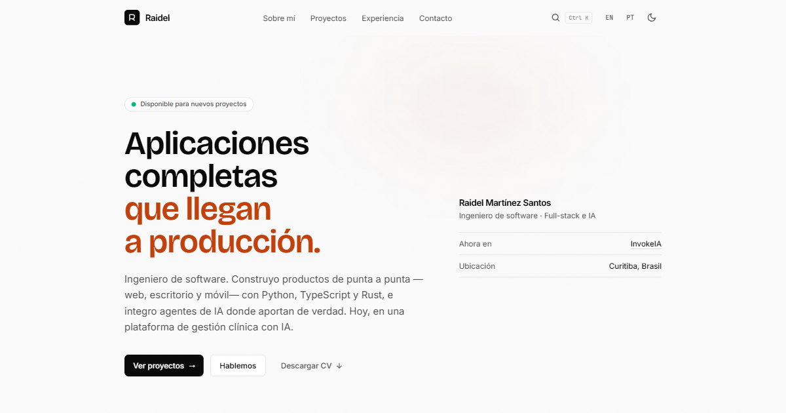

<div align="center">

# Raidel Martínez Santos — Portfolio

**Software Engineer · Full-stack & AI**

Sitio personal trilingüe (ES · EN · PT), estático y rápido, construido con Astro.

[**raidel-martinez.dev**](https://raidel-martinez.dev) · [LinkedIn](https://www.linkedin.com/in/raidel-martinez-santos) · [GitHub](https://github.com/YoshiLoL0526)


<br />



</div>

---

## ✦ Qué incluye

- **Tres idiomas** con rutas estáticas (`/es/`, `/en/`, `/pt/`), metadatos por idioma y `hreflang`.
- **Content collections** tipadas para proyectos y experiencia: cada entrada es un Markdown por idioma.
- **Proyectos filtrables** por búsqueda, categoría, tecnología y orden, con animación FLIP.
- **Paleta de comandos** (<kbd>Ctrl</kbd>/<kbd>⌘</kbd> + <kbd>K</kbd>) para saltar a secciones, abrir proyectos, cambiar idioma o tema.
- **Bit**, un pequeño robot guía que acompaña el scroll y explica cada sección.
- **View Transitions** con portadas compartidas entre listado y detalle, y reveals al hacer scroll.
- **Modo claro/oscuro** sobre un sistema de tokens propio.
- **CV descargable** en los tres idiomas, generado desde una única fuente de datos.
- **SEO**: sitemap, `robots.txt`, JSON-LD, imagen Open Graph y URLs canónicas.
- **Accesibilidad**: foco visible, buen contraste, `prefers-reduced-motion` y contenido legible sin JavaScript.

## ✦ Stack

| Área        | Herramientas                                                             |
| ----------- | ------------------------------------------------------------------------ |
| Framework   | [Astro 7](https://astro.build) (salida estática)                          |
| Lenguaje    | TypeScript                                                               |
| Estilos     | Tailwind CSS 4 + tokens CSS propios                                      |
| Tipografía  | Inter, JetBrains Mono y Bricolage Grotesque (Fontsource)                 |
| Iconos      | Simple Icons                                                             |
| Integración | `@astrojs/sitemap`                                                       |
| Hosting     | Hostinger (Apache/LiteSpeed) con `.htaccess` incluido en `public/`       |

## ✦ Empezar

Requiere **Node.js ≥ 22.23.4** y **pnpm**.

```bash
pnpm install
pnpm dev        # servidor de desarrollo en http://localhost:4321
pnpm build      # astro check + build estático en dist/
pnpm preview    # sirve dist/ localmente
pnpm cv         # regenera los CV en PDF (ES/EN/PT)
```

## ✦ Estructura

```text
src/
├── components/        # Secciones y piezas de UI (.astro)
├── content/
│   ├── projects/      # es/ · en/ · pt/  → un .md por proyecto e idioma
│   └── experience/    # es/ · en/ · pt/  → un .md por puesto e idioma
├── data/              # Datos personales, enlaces, skills y tecnologías
├── i18n/              # Textos de la interfaz y utilidades de rutas
├── layouts/           # Layout base (meta, SEO, tema)
├── lib/               # Consultas a las colecciones
├── pages/             # Rutas: /[lang]/, /[lang]/projects/, /[lang]/projects/[slug]/
└── styles/            # Tokens y estilos globales
scripts/
├── cv-data.mjs        # Contenido del CV en los tres idiomas
└── build-cv.mjs       # HTML → PDF con Chrome/Edge headless
public/                # favicon, og.png, robots.txt, .htaccess y CV en PDF
```

## ✦ Editar contenido

**Añadir un proyecto:** crea el mismo archivo en `src/content/projects/{es,en,pt}/` con este frontmatter:

```yaml
---
title: Mi proyecto
description: Una línea que resuma qué hace.
tags: [Astro, TypeScript]
category: web          # web · api · mobile · tool · ai · game
cover: ../../../assets/projects/mi-proyecto.png   # opcional
repo: https://github.com/...                     # opcional
demo: https://...                                # opcional
date: 2026-01-01
order: 10              # orden en la home y el listado
color: blue            # pink · blue · green · yellow · purple
---
```

**Experiencia:** igual, en `src/content/experience/{es,en,pt}/`, con `role`, `company`, `start`, `end` (vacío = puesto actual) y `type` (`work` o `education`).

**Datos personales y enlaces:** [`src/data/site.ts`](src/data/site.ts).
**Textos de la interfaz:** [`src/i18n/ui.ts`](src/i18n/ui.ts).

El esquema de las colecciones está en [`src/content.config.ts`](src/content.config.ts), y `astro check` valida cada entrada al compilar.

## ✦ CV en PDF

`pnpm cv` genera `public/cv-es.pdf`, `public/cv-en.pdf` y `public/cv-pt.pdf` a partir de [`scripts/cv-data.mjs`](scripts/cv-data.mjs). Usa Chrome o Edge en modo headless e incrusta las fuentes del proyecto, así que el resultado es el mismo en cualquier máquina.

## ✦ Despliegue

```bash
pnpm build
```

Sube el contenido de `dist/` a la raíz del hosting. El `.htaccess` (copiado desde `public/`) fuerza HTTPS, quita el `www`, sirve la página 404 propia, añade cabeceras de seguridad y cachea de forma permanente los assets con hash de `/_astro/`.

## ✦ Licencia

El código está bajo licencia [MIT](LICENSE): úsalo como base para tu propio portfolio.

El contenido personal (textos de proyectos y experiencia, CV, fotografía, capturas y datos de `src/data/site.ts`) no está incluido en la licencia. Si reutilizas el proyecto, sustitúyelo por el tuyo.

---

<div align="center">
<sub>Diseñado y desarrollado por <a href="https://raidel-martinez.dev">Raidel Martínez Santos</a>.</sub>
</div>
